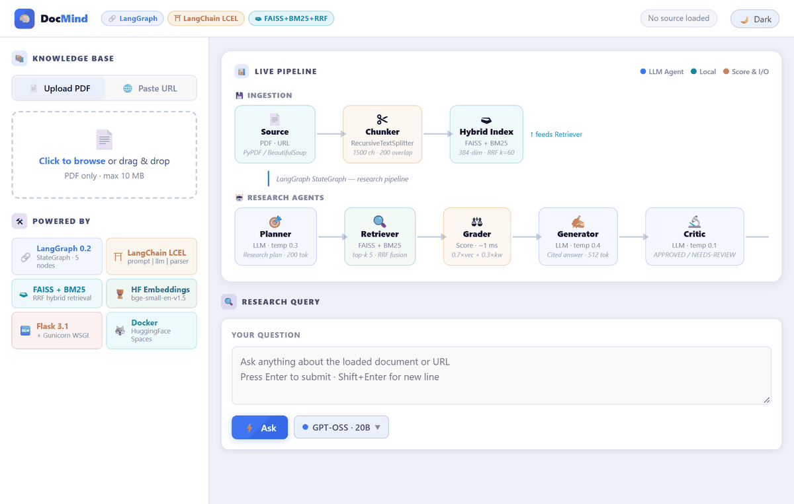
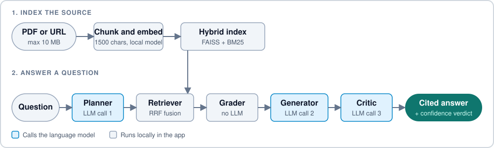

<!-- Generated from .github/README.md by scripts/sync_readme.py. Edit that file instead. -->

<div align="center">

# DocMind


[](https://huggingface.co/spaces/mnoorchenar/docmind)
[](https://mnoorchenar.github.io/)

[](https://www.python.org/)
[](https://flask.palletsprojects.com/)
[](https://github.com/langchain-ai/langgraph)
[](https://www.langchain.com/)
[](https://groq.com/)
[](https://www.docker.com/)
[](LICENSE)

**Most chat-with-your-PDF tools give one confident answer and no way to judge it.**<br>
DocMind retrieves with hybrid search, asks the model to cite the page for each claim, and has a second pass check the answer against the same passages.

[](#features) [](#how-it-works) [](#documentation) [](#author)



<table>
  <tr>
    <td align="center"><h3>3</h3>LLM calls per question, for 5 agents</td>
    <td align="center"><h3>32</h3>automated tests, none needing network or an API key</td>
    <td align="center"><h3>3</h3>selectable open models, switchable per question</td>
    <td align="center"><h3>$0</h3>to host, on a free CPU Space</td>
  </tr>
</table>

</div>

## Features

<table>
  <tr>
    <td width="50%"><b>Five-agent pipeline</b><br>A LangGraph state machine runs a planner, retriever, grader, generator and critic in order, and shows each step live in a trace panel.</td>
    <td width="50%"><b>Hybrid retrieval</b><br>FAISS vector search and BM25 keyword search are merged with Reciprocal Rank Fusion, so both paraphrases and exact terms are found.</td>
  </tr>
  <tr>
    <td><b>PDF and web page sources</b><br>Upload a PDF up to 10 MB or paste a public URL. Page numbers are kept so answers can cite them.</td>
    <td><b>Answer check</b><br>A critic pass compares the answer with the passages it was built from and labels it high confidence or worth verifying.</td>
  </tr>
  <tr>
    <td><b>Cheap grading</b><br>Chunk relevance comes from the search score and keyword overlap, so grading adds no LLM call and no wait.</td>
    <td><b>Model picker</b><br>Switch between GPT-OSS 20B, GPT-OSS 120B and Qwen 3.8 27B on Groq. Without a Groq key it falls back to the Hugging Face router.</td>
  </tr>
</table>

## How it works



## Documentation

<details>
<summary><b>Getting started</b></summary>

Requires Python 3.10+ and a free [Groq API key](https://console.groq.com/keys). Indexing runs locally and needs no key, but answering does. Instead of Groq, you can set a Hugging Face token with the **Make calls to Inference Providers** permission.

```bash
git clone https://github.com/mnoorchenar/docmind.git
cd docmind

python -m venv venv
source venv/bin/activate     # Windows: venv\Scripts\activate
pip install -r requirements.txt

cp .env.example .env         # then set GROQ_API_KEY
python app.py
```

Then open http://localhost:7860. Or use Docker:

```bash
docker build -t docmind .
docker run -p 7860:7860 -e GROQ_API_KEY=your_key docmind
```

</details>

<details>
<summary><b>Engineering decisions</b></summary>

| Decision | Why |
|---|---|
| Combine FAISS and BM25 with Reciprocal Rank Fusion | Vector search finds paraphrases but can miss exact names and numbers, and BM25 does the reverse. RRF merges ranks, so the two score scales never need calibrating. |
| Grade chunks by score instead of asking an LLM | Free-tier inference is rate limited, and a grading call per chunk would multiply the waiting. The search score plus keyword overlap is instant and repeatable. |
| Run embeddings locally and download the model at image build | Indexing uses no API quota, and the first request doesn't wait for a model download. |
| Use one OpenAI-compatible client for Groq and the Hugging Face router | Providers and models are table entries, so adding or swapping one needs no new code. |
| Keep the graph linear, with no retry loop | The number of LLM calls per question is fixed at three, which keeps latency and free-tier usage predictable. |
| Judge the answer against the same chunks the generator saw | A critic that sees different text than the generator can approve or reject for the wrong reasons. |
| Normalise grades by the best possible RRF score | Raw RRF scores are tiny (at most 0.033), so an unscaled threshold either keeps everything or nothing. |
| Fetch only public addresses, checking every redirect | The URL box makes the server fetch for the visitor. Without a check it could be pointed at internal addresses. |
| Keep the key server-side and run a single worker | The browser never sees the key. The index and query history live in process memory, so one worker keeps them consistent. |
| Cap stored query history | Traces are kept in memory, so the oldest are dropped to stop a long-running Space from growing without limit. |

</details>

<details>
<summary><b>Limitations</b></summary>

- **One source for everyone.** The index is global to the server. Loading a document replaces the one another visitor may be asking about, and a restart clears it.
- **Answers are not verified facts.** The critic is a language model judging another model's output, so its verdict is a heuristic. Check important claims against the source.
- **The plan doesn't steer retrieval.** The planner's text appears in the trace, but the retriever searches with the original question.
- **Scanned PDFs don't work.** Text is extracted with pypdf and there is no OCR, so image-only files are rejected.
- **Some sites can't be fetched.** Pages that block automated requests, need JavaScript to render, or sit behind a login return an error. Web pages are cut at about 15,000 words.
- **Inference depends on a valid key and a free tier.** If the key is missing or rejected, questions fail with an error that says so. Provider rate limits can also pause answers.
- **The critic is not stable.** Run twice on the same question, it can approve once and flag the answer the next time. Treat the verdict as a hint.
- **Citations depend on the model.** The prompt asks for `[Source: file, p.N]` markers, but some models, such as GPT-OSS, often omit them.
- **No quantitative answer-quality benchmark yet.** Retrieval and answer accuracy haven't been measured on a labelled question set.

</details>

<details>
<summary><b>Configuration</b></summary>

| Variable | Default | Purpose |
|---|---|---|
| `GROQ_API_KEY` | none | Groq API key. When set, Groq is the provider. |
| `HF_TOKEN` | none | Hugging Face token for the inference router, used only if `GROQ_API_KEY` isn't set. |
| `SECRET_KEY` | random per start | Flask secret key |

One of the two keys is needed to answer questions. The embedding model (`BAAI/bge-small-en-v1.5`) and the selectable LLMs are set in `rag/embeddings.py` and `agents/llm_factory.py`.

</details>

<details>
<summary><b>API</b></summary>

`POST` endpoints take and return JSON, except upload, which takes a multipart form.

| Endpoint | Body | Returns |
|---|---|---|
| `POST /api/upload` | `file` (PDF, up to 10 MB) | Filename and chunk count |
| `POST /api/ingest_url` | `url` | URL and chunk count |
| `POST /api/research` | `question`, `model` (optional) | `query_id` |
| `GET /api/trace/<query_id>` | none | Status, step-by-step trace and, when complete, the answer and verdict |
| `GET /api/models` | none | Available models and the current one |
| `POST /api/set_model` | `model` | Confirmation of the active model |
| `GET /health` | none | Service status, provider, indexed chunk count and active model |

</details>

<details>
<summary><b>Tests</b></summary>

```bash
pip install -r requirements.txt pytest
pytest
```

The tests replace embeddings and LLM calls with fakes, so they need no network, model download or API key. They cover the grader, chunk selection, hybrid search, the address check for URLs, error messages, bounded history and the Flask routes. One test checks that this README and the Hugging Face copy of it stay identical.

</details>

<details>
<summary><b>Project structure</b></summary>

```
app.py                  Flask app and API routes
agents/                 Planner, retriever, grader, generator, critic, LLM factory
graph/                  LangGraph pipeline
rag/                    PDF and URL ingestion, embeddings, hybrid vector store
tracing/                In-memory step trace for the live panel
templates/              Single-page frontend
docs/                   Figures used in this README
scripts/sync_readme.py  Builds the Hugging Face README from .github/README.md
tests/                  Test suite
Dockerfile              Gunicorn on port 7860, embedding model baked in
```

</details>

> [!WARNING]
> This project is for research and education only. Answers are AI-generated and can be wrong or incomplete, so verify them against the source. Uploaded files and fetched pages are kept in server memory and disk until replaced or the server restarts.

## Author

<div align="center">
<table>
  <tr>
    <td align="center" width="170">
      <a href="https://mnoorchenar.github.io/"></a>
    </td>
    <td>
      <h3><a href="https://mnoorchenar.github.io/">Mohammad Noorchenarboo</a></h3>
      Data Scientist · AI Researcher · Biostatistician<br>
      Ontario, Canada<br><br>
      <a href="https://mnoorchenar.github.io/"></a>
      <a href="https://www.linkedin.com/in/mnoorchenar"></a>
      <a href="https://scholar.google.ca/citations?user=nn_Toq0AAAAJ&hl=en"></a>
      <a href="https://huggingface.co/mnoorchenar"></a>
      <a href="mailto:mohammadnoorchenarboo@gmail.com"></a>
    </td>
  </tr>
</table>

Released under the [MIT License](LICENSE).

</div>
